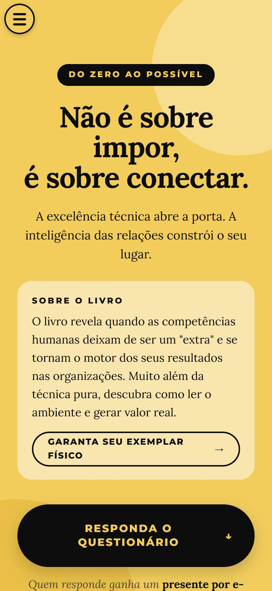
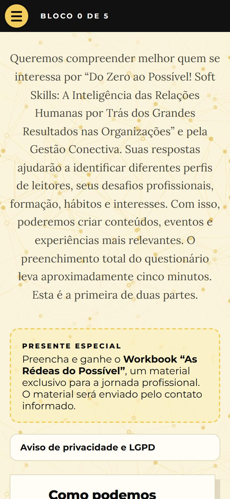
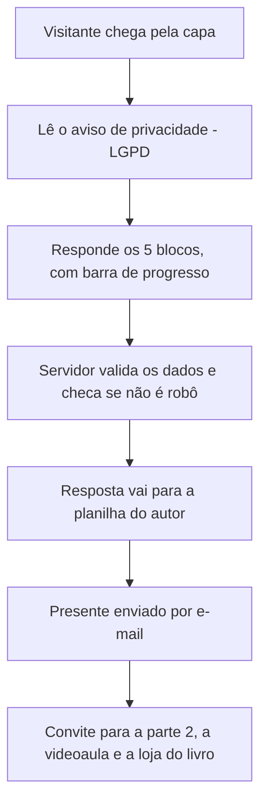

# Questionário "Do Zero ao Possível"

> **A pergunta central:** como um autor pode conhecer de verdade quem se interessa pelo seu livro (perfil, desafios e interesses) e fazer as pessoas quererem responder uma pesquisa longa até o fim?

Site de pesquisa de leitores para o livro **"Do Zero ao Possível! Soft Skills: a inteligência das relações humanas por trás dos grandes resultados nas organizações"**, de Ivan de Souza Dutra.

Quem responde ao questionário recebe um material de presente, e as respostas chegam organizadas numa planilha para o autor conhecer melhor o seu público.

**Site no ar:** https://questionario-m0rl.onrender.com

---

## Telas

Feito primeiro para o celular (*mobile first*):

| Capa | Questionário |
|:---:|:---:|
|  |  |

---

## Funcionalidades

- **Questionário em 5 blocos** com barra de progresso ("Bloco 1 de 5") e uma **segunda parte opcional**
- **Validação dos campos** no navegador e no servidor (e-mail, WhatsApp com DDD, campos obrigatórios)
- **Aviso de privacidade (LGPD)** antes de qualquer dado ser enviado
- **Presente automático**: ao concluir, a pessoa recebe o workbook por e-mail
- **Respostas vão direto para uma planilha Google**, prontas para análise
- **Páginas extras**: sobre o livro, sobre o autor e videoaula
- **Menu lateral** e visual próprio, com fundo de "conexões" que conversa com o tema do livro
- **Integração com a loja do livro** ([ver projeto](https://github.com/abreuairan/loja-do-zero-ao-possivel))

## Como uma resposta funciona



## Decisões e por quê

| Decisão | Por quê |
|---|---|
| Dividir em 5 blocos com barra de progresso | Um formulário enorme numa tela só assusta. Em blocos, a pessoa vê que está avançando e chega ao fim |
| Dar um presente para quem responde | Um motivo concreto para responder tudo, e não abandonar na metade |
| Validar no navegador **e** no servidor | No navegador para ajudar quem está digitando. No servidor porque o navegador pode ser burlado |
| Campo-armadilha invisível contra robôs | Pessoas não veem o campo e deixam vazio; robôs preenchem tudo e são barrados, sem precisar de CAPTCHA chato |
| Links de acesso assinados e com validade | Só quem respondeu de verdade consegue abrir o presente e a videoaula. Ninguém consegue "inventar" o link |
| Respostas numa planilha Google | O autor analisa os dados sozinho, no formato que já conhece |

## Segurança e cuidado com os dados

- Nenhuma senha ou chave fica no código: tudo em **variáveis de ambiente** no servidor
- **Proteção contra robôs**: campo-armadilha invisível e tempo mínimo de preenchimento
- **Limite de envios por visitante**, para evitar spam
- **Links de acesso assinados** (com validade), para que ninguém "fabrique" o acesso ao presente ou à videoaula
- Cabeçalhos de segurança nas respostas do servidor
- Os dados das pessoas **nunca** vão para o repositório

## Tecnologias

| Parte | O que usei |
|---|---|
| Front-end | HTML5, CSS3 (responsivo, *mobile first*), JavaScript puro |
| Back-end | Python 3, Flask, Jinja2, itsdangerous |
| Dados e e-mail | Google Apps Script + Google Planilhas, Gmail |
| Hospedagem | Render (com Gunicorn) |
| Ferramentas | VS Code, Git e GitHub |

---

## O que tem neste repositório

Este é um **repositório-vitrine**: ele mostra a parte visual do projeto (o que roda no navegador).

```
templates/   páginas HTML (Jinja2): capa, questionário, parte 2, livro, autor, obrigado, videoaula
static/      CSS, JavaScript e imagens
prints/      capturas de tela do site
```

O **back-end** (servidor em Flask, integração com a planilha e o envio de e-mails) é **privado**, porque lida com dados pessoais dos participantes. Por isso o projeto não roda só com estes arquivos. Para ver funcionando, acesse o [site no ar](https://questionario-m0rl.onrender.com).

## O que aprendi

- Montar um formulário longo sem cansar quem responde (blocos, progresso, textos curtos)
- Validar dados dos dois lados: no navegador (para ajudar) e no servidor (para proteger)
- Guardar segredos em variáveis de ambiente e manter dados pessoais fora do Git
- Ligar um site Python a ferramentas do Google com Apps Script
- Publicar e manter um site no ar no Render

---

Desenvolvido por **Airan Abreu Tavares** · [@abreuairan](https://github.com/abreuairan)

Projeto feito para um cliente e publicado aqui com autorização. © Todos os direitos reservados: o código pode ser visto para avaliação, mas não pode ser copiado ou reutilizado sem permissão.
